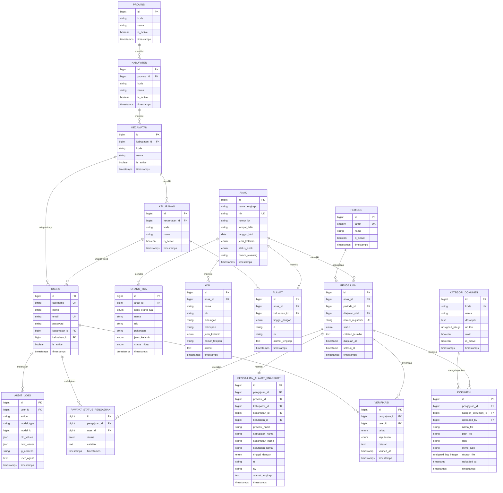

# Database Design — Manajemen Data Anak Yatim (SAHABAT)

> **Status:** Rancangan awal / baseline  
> **Tujuan:** Menjadi acuan pembuatan Laravel Migration, Model, Relationship, Filament Resource, authorization, dan workflow verifikasi.  
> **Workflow utama:** Kelurahan → Kecamatan → Kesra

---

## 1. Prinsip Arsitektur

Database dipisahkan menjadi beberapa domain:

1. **Master wilayah**
   - Provinsi
   - Kabupaten/Kota
   - Kecamatan
   - Kelurahan

2. **Identitas anak**
   - Anak
   - Orang tua
   - Wali
   - Alamat

3. **Pengajuan bantuan**
   - Pengajuan
   - Snapshot alamat pengajuan
   - Kategori dokumen
   - Dokumen

4. **Workflow**
   - Riwayat status pengajuan
   - Verifikasi

5. **Pengguna dan keamanan**
   - Users
   - Spatie Permission
   - Audit logs

### Prinsip penting

**Biodata anak tidak disamakan dengan pengajuan.**

```text
anak
 ├── orang_tua
 ├── wali
 ├── alamat
 └── pengajuan
      ├── snapshot alamat
      ├── dokumen
      ├── verifikasi
      └── riwayat status
```

Dengan desain ini, perubahan biodata atau alamat terbaru tidak merusak histori pengajuan lama.

---

# 2. ERD



---

# 3. Master Wilayah

## 3.1 `provinsi`

Menyimpan data provinsi.

| Kolom | Tipe | Aturan |
|---|---|---|
| id | BIGINT | PK |
| kode | VARCHAR(20) | UNIQUE, nullable jika sumber data tidak menyediakan |
| nama | VARCHAR(100) | NOT NULL |
| is_active | BOOLEAN | default true |
| created_at | TIMESTAMP | |
| updated_at | TIMESTAMP | |

### Relasi

```text
Provinsi hasMany Kabupaten
```

---

## 3.2 `kabupaten`

Ditambahkan karena struktur wilayah administratif yang benar adalah:

```text
Provinsi
└── Kabupaten/Kota
    └── Kecamatan
        └── Kelurahan
```

| Kolom | Tipe | Aturan |
|---|---|---|
| id | BIGINT | PK |
| provinsi_id | BIGINT | FK → provinsi.id |
| kode | VARCHAR(20) | UNIQUE |
| nama | VARCHAR(100) | NOT NULL |
| is_active | BOOLEAN | default true |
| created_at | TIMESTAMP | |
| updated_at | TIMESTAMP | |

### Relasi

```text
Kabupaten belongsTo Provinsi
Kabupaten hasMany Kecamatan
```

---

## 3.3 `kecamatan`

| Kolom | Tipe | Aturan |
|---|---|---|
| id | BIGINT | PK |
| kabupaten_id | BIGINT | FK → kabupaten.id |
| kode | VARCHAR(20) | UNIQUE |
| nama | VARCHAR(100) | NOT NULL |
| is_active | BOOLEAN | default true |
| created_at | TIMESTAMP | |
| updated_at | TIMESTAMP | |

### Relasi

```text
Kecamatan belongsTo Kabupaten
Kecamatan hasMany Kelurahan
```

---

## 3.4 `kelurahan`

| Kolom | Tipe | Aturan |
|---|---|---|
| id | BIGINT | PK |
| kecamatan_id | BIGINT | FK → kecamatan.id |
| kode | VARCHAR(20) | UNIQUE |
| nama | VARCHAR(100) | NOT NULL |
| is_active | BOOLEAN | default true |
| created_at | TIMESTAMP | |
| updated_at | TIMESTAMP | |

### Relasi

```text
Kelurahan belongsTo Kecamatan
Kelurahan hasMany Alamat
```

---

# 4. Users dan Role

## 4.1 `users`

Sistem memiliki tiga kelompok pengguna utama:

```text
Kelurahan
Kecamatan
Kesra
```

Role sebaiknya dikelola menggunakan **Spatie Laravel Permission**, bukan kolom role manual.

### Kolom

| Kolom | Tipe | Aturan |
|---|---|---|
| id | BIGINT | PK |
| username | VARCHAR(50) | UNIQUE, NOT NULL |
| name | VARCHAR(150) | NOT NULL |
| email | VARCHAR(255) | UNIQUE, NOT NULL |
| password | VARCHAR(255) | NOT NULL |
| kecamatan_id | BIGINT | FK, nullable |
| kelurahan_id | BIGINT | FK, nullable |
| is_active | BOOLEAN | default true |
| remember_token | VARCHAR(100) | nullable |
| created_at | TIMESTAMP | |
| updated_at | TIMESTAMP | |

### Aturan wilayah

#### User Kelurahan

```text
role = admin_kelurahan
kelurahan_id = wajib
kecamatan_id = nullable
```

#### User Kecamatan

```text
role = admin_kecamatan
kecamatan_id = wajib
kelurahan_id = NULL
```

#### User Kesra

```text
role = admin_kesra
kecamatan_id = NULL
kelurahan_id = NULL
```

Kesra mempunyai akses lintas wilayah sesuai kewenangan sistem.

### Catatan keamanan

`kelurahan_id` dan `kecamatan_id` **tidak boleh dipercaya dari input form biasa**.

Scope harus ditentukan dari user yang sedang login dan diperiksa di server-side authorization.

---

# 5. `anak`

Menyimpan biodata utama anak.

| Kolom | Tipe | Aturan |
|---|---|---|
| id | BIGINT | PK |
| nama_lengkap | VARCHAR(150) | NOT NULL |
| nik | CHAR(16) | UNIQUE, NOT NULL |
| nomor_kk | CHAR(16) | nullable |
| tempat_lahir | VARCHAR(100) | NOT NULL |
| tanggal_lahir | DATE | NOT NULL |
| jenis_kelamin | ENUM | `laki_laki`, `perempuan` |
| status_anak | ENUM | `yatim`, `piatu`, `yatim_piatu` |
| nomor_rekening | VARCHAR(50) | nullable |
| created_at | TIMESTAMP | |
| updated_at | TIMESTAMP | |

### Catatan

`nomor_kk` dan `nomor_rekening` ditambahkan karena relevan dengan dokumen administrasi bantuan.

Jika kebutuhan bisnis final ternyata tidak memerlukan penyimpanan kedua data tersebut secara terstruktur, kolom dapat dihapus.

### Constraint

```text
nik UNIQUE
```

NIK harus divalidasi:

```text
required
digits:16
```

---

# 6. `orang_tua`

Satu anak **wajib mempunyai dua orang tua**:

```text
ayah
ibu
```

### Kolom

| Kolom | Tipe | Aturan |
|---|---|---|
| id | BIGINT | PK |
| anak_id | BIGINT | FK → anak.id |
| jenis_orang_tua | ENUM | `ayah`, `ibu` |
| nama | VARCHAR(150) | NOT NULL |
| nik | CHAR(16) | nullable |
| pekerjaan | VARCHAR(150) | nullable |
| jenis_kelamin | ENUM | `laki_laki`, `perempuan` |
| status_hidup | ENUM | `hidup`, `meninggal`, `tidak_diketahui` |
| created_at | TIMESTAMP | |
| updated_at | TIMESTAMP | |

### Constraint

```text
UNIQUE(anak_id, jenis_orang_tua)
```

Dengan demikian satu anak tidak dapat mempunyai:

```text
ayah
ayah
ibu
```

### Aturan aplikasi

Jika:

```text
jenis_orang_tua = ayah
```

maka:

```text
jenis_kelamin = laki_laki
```

Jika:

```text
jenis_orang_tua = ibu
```

maka:

```text
jenis_kelamin = perempuan
```

User tidak boleh memilih gender orang tua secara bebas.

### Aturan bisnis

Pada saat data anak dinyatakan lengkap:

```text
jumlah orang tua = 2
```

dan harus terdapat:

```text
ayah
ibu
```

---

# 7. `wali`

Tabel wali diperlukan karena salah satu dokumen adalah:

```text
Fotocopy KTP Orang Tua/Wali
```

dan anak dapat memiliki kondisi:

```text
tinggal dengan kerabat
```

### Kolom

| Kolom | Tipe | Aturan |
|---|---|---|
| id | BIGINT | PK |
| anak_id | BIGINT | FK → anak.id |
| nama | VARCHAR(150) | NOT NULL |
| nik | CHAR(16) | nullable |
| hubungan | VARCHAR(100) | NOT NULL |
| pekerjaan | VARCHAR(150) | nullable |
| jenis_kelamin | ENUM | `laki_laki`, `perempuan` |
| nomor_telepon | VARCHAR(30) | nullable |
| alamat | TEXT | nullable |
| created_at | TIMESTAMP | |
| updated_at | TIMESTAMP | |

### Catatan

Wali tidak wajib untuk semua anak.

Wali menjadi relevan jika kondisi anak membutuhkan wali, misalnya:

```text
tinggal_dengan = kerabat
```

---

# 8. `alamat`

Menyimpan alamat aktif anak.

### Kolom

| Kolom | Tipe | Aturan |
|---|---|---|
| id | BIGINT | PK |
| anak_id | BIGINT | FK → anak.id, UNIQUE |
| kelurahan_id | BIGINT | FK → kelurahan.id |
| tinggal_dengan | ENUM | `orang_tua`, `sendiri`, `kerabat`, `lainnya` |
| rt | VARCHAR(5) | NOT NULL |
| rw | VARCHAR(5) | NOT NULL |
| alamat_lengkap | TEXT | NOT NULL |
| created_at | TIMESTAMP | |
| updated_at | TIMESTAMP | |

### Wilayah otomatis

Jangan menyimpan:

```text
wilayah = "Kerinci"
```

sebagai teks bebas.

Gunakan:

```text
alamat.kelurahan_id
        ↓
kelurahan.kecamatan_id
        ↓
kecamatan.kabupaten_id
        ↓
kabupaten.provinsi_id
```

Dengan demikian wilayah otomatis diperoleh dari relasi database.

### Aturan keamanan

Kelurahan yang dapat digunakan harus sesuai dengan:

```text
users.kelurahan_id
```

untuk user Kelurahan.

---

# 9. `periode`

Menyimpan periode/tahun bantuan.

### Kolom

| Kolom | Tipe | Aturan |
|---|---|---|
| id | BIGINT | PK |
| tahun | SMALLINT | UNIQUE |
| nama | VARCHAR(100) | NOT NULL |
| is_active | BOOLEAN | default true |
| created_at | TIMESTAMP | |
| updated_at | TIMESTAMP | |

Contoh:

```text
2026
2027
2028
```

---

# 10. `pengajuan`

Tabel inti untuk proses permohonan bantuan.

### Kolom

| Kolom | Tipe | Aturan |
|---|---|---|
| id | BIGINT | PK |
| anak_id | BIGINT | FK → anak.id |
| periode_id | BIGINT | FK → periode.id |
| diajukan_oleh | BIGINT | FK → users.id |
| nomor_registrasi | VARCHAR(50) | UNIQUE |
| status | ENUM | lihat daftar status |
| catatan_terakhir | TEXT | nullable |
| diajukan_at | TIMESTAMP | nullable |
| selesai_at | TIMESTAMP | nullable |
| created_at | TIMESTAMP | |
| updated_at | TIMESTAMP | |

### Status pengajuan

```text
draft
diajukan_ke_kecamatan
dikembalikan_ke_kelurahan
diverifikasi_kecamatan
diajukan_ke_kesra
dikembalikan_ke_kecamatan
disetujui
ditolak
```

### Alur

```text
draft
  ↓
diajukan_ke_kecamatan
  ↓
┌─────────────────────────────┐
│ Kecamatan                   │
├─────────────────────────────┤
│ dikembalikan_ke_kelurahan   │
│ atau                        │
│ diverifikasi_kecamatan      │
└─────────────────────────────┘
              ↓
     diajukan_ke_kesra
              ↓
┌─────────────────────────────┐
│ Kesra                       │
├─────────────────────────────┤
│ dikembalikan_ke_kecamatan   │
│ atau                        │
│ disetujui                   │
│ atau                        │
│ ditolak                     │
└─────────────────────────────┘
```

### Aturan

Pengajuan yang dikembalikan **diperbaiki pada pengajuan yang sama**, bukan membuat pengajuan baru.

Dengan demikian histori tetap utuh.

---

# 11. Nomor Registrasi

Setiap pengajuan mempunyai nomor registrasi.

Contoh:

```text
SAHABAT-2026-000001
SAHABAT-2026-000002
```

Nomor registrasi harus:

```text
UNIQUE
```

dan dibuat server-side.

User tidak boleh menentukan nomor registrasi sendiri.

---

# 12. Snapshot Alamat Pengajuan

## `pengajuan_alamat_snapshot`

Snapshot menyimpan kondisi alamat ketika pengajuan dibuat.

### Kolom

| Kolom | Tipe | Aturan |
|---|---|---|
| id | BIGINT | PK |
| pengajuan_id | BIGINT | FK → pengajuan.id, UNIQUE |
| provinsi_id | BIGINT | FK |
| kabupaten_id | BIGINT | FK |
| kecamatan_id | BIGINT | FK |
| kelurahan_id | BIGINT | FK |
| provinsi_nama | VARCHAR(100) | NOT NULL |
| kabupaten_nama | VARCHAR(100) | NOT NULL |
| kecamatan_nama | VARCHAR(100) | NOT NULL |
| kelurahan_nama | VARCHAR(100) | NOT NULL |
| tinggal_dengan | ENUM | NOT NULL |
| rt | VARCHAR(5) | NOT NULL |
| rw | VARCHAR(5) | NOT NULL |
| alamat_lengkap | TEXT | NOT NULL |
| created_at | TIMESTAMP | |
| updated_at | TIMESTAMP | |

### Mengapa menyimpan ID sekaligus nama?

ID mempertahankan hubungan terhadap master.

Nama disimpan sebagai snapshot agar histori tetap dapat dibaca walaupun nama master wilayah berubah.

Contoh:

```text
Pengajuan 2026
Kelurahan: Kelurahan A
```

Jika master kemudian berubah menjadi:

```text
Kelurahan A Baru
```

pengajuan historis tetap menunjukkan nama pada saat pengajuan.

---

# 13. `kategori_dokumen`

Semua 11 kategori dokumen berstatus **WAJIB**.

### Kolom

| Kolom | Tipe | Aturan |
|---|---|---|
| id | BIGINT | PK |
| kode | VARCHAR(50) | UNIQUE |
| nama | VARCHAR(255) | NOT NULL |
| deskripsi | TEXT | nullable |
| urutan | UNSIGNED INT | NOT NULL |
| wajib | BOOLEAN | default true |
| is_active | BOOLEAN | default true |
| created_at | TIMESTAMP | |
| updated_at | TIMESTAMP | |

---

# 14. Seed 11 Kategori Dokumen

Data awal:

| Urutan | Kode | Nama | Wajib |
|---:|---|---|---|
| 1 | SPPA | Surat Permohonan Pengajuan | YA |
| 2 | SPP | Surat Permohonan Pencairan | YA |
| 3 | KTP_ORANG_TUA_WALI | Fotocopy KTP Orang Tua/Wali | YA |
| 4 | KK | Fotocopy Kartu Keluarga | YA |
| 5 | AKTA_KELAHIRAN | Fotocopy Akte Kelahiran / Surat Keterangan Lahir dari Lurah | YA |
| 6 | AKTA_KEMATIAN | Fotocopy Akte Kematian Orangtua / Surat Keterangan Kematian dari Lurah | YA |
| 7 | PERNYATAAN_ANAK_YATIM | Surat Pernyataan Benar Permohonan Anak Yatim | YA |
| 8 | PERNYATAAN_KEBENARAN_DOKUMEN | Surat Pernyataan Kebenaran Dokumen | YA |
| 9 | SP_TANGGUNG_JAWAB | Surat Pernyataan Tanggungjawab Penggunaan Belanja Bantuan Sosial Permohonan | YA |
| 10 | REKENING_BANK | Fotocopy Rekening Bank Riau Kepri Syariah | YA |
| 11 | PAS_FOTO | Pas Foto Ukuran 3x4 (Warna) | YA |

### Catatan

Nama kategori sebaiknya disimpan sebagai data seed, bukan di-hardcode di banyak tempat.

---

# 15. `dokumen`

Dokumen dimiliki oleh **pengajuan**, bukan langsung oleh anak.

### Kolom

| Kolom | Tipe | Aturan |
|---|---|---|
| id | BIGINT | PK |
| pengajuan_id | BIGINT | FK → pengajuan.id |
| kategori_dokumen_id | BIGINT | FK → kategori_dokumen.id |
| uploaded_by | BIGINT | FK → users.id |
| nama_file | VARCHAR(255) | NOT NULL |
| path_file | VARCHAR(500) | NOT NULL |
| disk | VARCHAR(50) | NOT NULL |
| mime_type | VARCHAR(100) | NOT NULL |
| ukuran_file | BIGINT | NOT NULL |
| uploaded_at | TIMESTAMP | NOT NULL |
| created_at | TIMESTAMP | |
| updated_at | TIMESTAMP | |

### Constraint

```text
UNIQUE(pengajuan_id, kategori_dokumen_id)
```

Artinya satu pengajuan hanya memiliki satu file aktif untuk setiap kategori.

Contoh:

```text
Pengajuan #100
├── KK
├── Akta Kelahiran
├── KTP
├── Pas Foto
└── ...
```

hingga seluruh 11 kategori terpenuhi.

### Revisi dokumen

Jika file salah:

```text
KK.pdf
```

diganti:

```text
KK-revisi.pdf
```

maka record dokumen yang sama diperbarui.

Histori aktivitas tetap dapat dilacak melalui `audit_logs`.

---

# 16. Validasi Kelengkapan 11 Dokumen

Sebelum pengajuan dapat:

```text
diajukan_ke_kecamatan
```

sistem harus memastikan seluruh kategori wajib memiliki dokumen.

Secara logika:

```text
jumlah kategori wajib aktif = 11
jumlah dokumen pengajuan = 11
```

Jika kurang:

```text
Pengajuan tidak dapat dikirim.
```

Jangan hanya mengandalkan validasi Filament.

Validasi penting juga harus berada pada server-side/business logic.

---

# 17. `riwayat_status_pengajuan`

Menyimpan seluruh perubahan status pengajuan.

### Kolom

| Kolom | Tipe | Aturan |
|---|---|---|
| id | BIGINT | PK |
| pengajuan_id | BIGINT | FK |
| user_id | BIGINT | FK → users.id |
| status | ENUM | status yang dicapai |
| catatan | TEXT | nullable, tetapi wajib untuk pengembalian/penolakan |
| created_at | TIMESTAMP | |
| updated_at | TIMESTAMP | |

### Contoh histori

```text
17-09-2026
Kelurahan
draft

17-09-2026
Kelurahan
diajukan_ke_kecamatan

18-09-2026
Kecamatan
dikembalikan_ke_kelurahan
Catatan:
"Dokumen KK tidak terbaca."

19-09-2026
Kelurahan
diajukan_ke_kecamatan

20-09-2026
Kecamatan
diverifikasi_kecamatan

20-09-2026
Kecamatan
diajukan_ke_kesra

21-09-2026
Kesra
disetujui
```

---

# 18. `verifikasi`

Menyimpan aktivitas verifikasi secara terstruktur.

### Kolom

| Kolom | Tipe | Aturan |
|---|---|---|
| id | BIGINT | PK |
| pengajuan_id | BIGINT | FK |
| user_id | BIGINT | FK |
| tahap | ENUM | `kecamatan`, `kesra` |
| keputusan | ENUM | `diterima`, `dikembalikan`, `ditolak` |
| catatan | TEXT | nullable |
| verified_at | TIMESTAMP | NOT NULL |
| created_at | TIMESTAMP | |
| updated_at | TIMESTAMP | |

### Perbedaan dengan riwayat status

| Tabel | Fungsi |
|---|---|
| `riwayat_status_pengajuan` | Histori workflow |
| `verifikasi` | Rekam keputusan verifikasi |
| `audit_logs` | Rekam aktivitas sistem |

Ketiganya bukan duplikasi.

---

# 19. `audit_logs`

Digunakan untuk audit keamanan dan akuntabilitas.

### Kolom

| Kolom | Tipe | Aturan |
|---|---|---|
| id | BIGINT | PK |
| user_id | BIGINT | FK → users.id, nullable |
| action | VARCHAR(100) | NOT NULL |
| model_type | VARCHAR(255) | NOT NULL |
| model_id | BIGINT | nullable |
| old_values | JSON | nullable |
| new_values | JSON | nullable |
| ip_address | VARCHAR(45) | nullable |
| user_agent | TEXT | nullable |
| created_at | TIMESTAMP | |

### Contoh action

```text
created
updated
deleted
submitted
verified
returned
approved
rejected
uploaded
replaced
```

---

# 20. Relasi Utama

## Anak

```text
Anak
 ├── hasMany OrangTua
 ├── hasMany Wali
 ├── hasOne Alamat
 └── hasMany Pengajuan
```

## Orang Tua

```text
OrangTua
 └── belongsTo Anak
```

## Wali

```text
Wali
 └── belongsTo Anak
```

## Alamat

```text
Alamat
 ├── belongsTo Anak
 └── belongsTo Kelurahan
```

## Pengajuan

```text
Pengajuan
 ├── belongsTo Anak
 ├── belongsTo Periode
 ├── belongsTo User sebagai diajukan_oleh
 ├── hasOne PengajuanAlamatSnapshot
 ├── hasMany Dokumen
 ├── hasMany RiwayatStatusPengajuan
 └── hasMany Verifikasi
```

## Dokumen

```text
Dokumen
 ├── belongsTo Pengajuan
 ├── belongsTo KategoriDokumen
 └── belongsTo User sebagai uploader
```

---

# 21. Workflow Bisnis

## 21.1 Kelurahan membuat data anak

```text
Login Kelurahan
    ↓
Tambah Anak
    ↓
Isi Biodata Anak
    ↓
Isi Ayah
    ↓
Isi Ibu
    ↓
Isi Alamat
    ↓
Opsional: Isi Wali
```

Sistem memastikan wilayah anak sesuai dengan wilayah kerja user.

---

## 21.2 Membuat pengajuan

```text
Data Anak
    ↓
Buat Pengajuan
    ↓
Pilih Periode
    ↓
Generate Nomor Registrasi
    ↓
Snapshot Alamat
    ↓
Upload 11 Dokumen
```

Status:

```text
draft
```

---

## 21.3 Pengajuan ke Kecamatan

Sistem memeriksa:

- Biodata lengkap.
- Ayah tersedia.
- Ibu tersedia.
- Alamat tersedia.
- Periode aktif.
- 11 dokumen wajib tersedia.
- User mempunyai kewenangan atas wilayah tersebut.

Jika valid:

```text
draft
↓
diajukan_ke_kecamatan
```

---

## 21.4 Kecamatan

Kecamatan dapat:

### Mengembalikan

```text
diajukan_ke_kecamatan
↓
dikembalikan_ke_kelurahan
```

Wajib memberikan catatan.

### Memverifikasi

```text
diajukan_ke_kecamatan
↓
diverifikasi_kecamatan
```

Kemudian:

```text
diverifikasi_kecamatan
↓
diajukan_ke_kesra
```

---

## 21.5 Kesra

Kesra dapat:

### Mengembalikan

```text
diajukan_ke_kesra
↓
dikembalikan_ke_kecamatan
```

Wajib memberikan catatan.

### Menyetujui

```text
diajukan_ke_kesra
↓
disetujui
```

### Menolak

```text
diajukan_ke_kesra
↓
ditolak
```

Penolakan wajib mempunyai catatan/alasan.

---

# 22. Aturan Pengembalian

Pengajuan yang dikembalikan **tidak membuat pengajuan baru**.

Contoh:

```text
Pengajuan:
SAHABAT-2026-000123
```

Jika Kecamatan mengembalikan:

```text
SAHABAT-2026-000123
status:
dikembalikan_ke_kelurahan
```

Setelah diperbaiki:

```text
SAHABAT-2026-000123
status:
diajukan_ke_kecamatan
```

Nomor registrasi tetap sama.

---

# 23. Aturan Status

| Status | Aktor |
|---|---|
| `draft` | Kelurahan |
| `diajukan_ke_kecamatan` | Kelurahan |
| `dikembalikan_ke_kelurahan` | Kecamatan |
| `diverifikasi_kecamatan` | Kecamatan |
| `diajukan_ke_kesra` | Kecamatan |
| `dikembalikan_ke_kecamatan` | Kesra |
| `disetujui` | Kesra |
| `ditolak` | Kesra |

### Transisi yang diperbolehkan

```text
draft
→ diajukan_ke_kecamatan

diajukan_ke_kecamatan
→ dikembalikan_ke_kelurahan
→ diverifikasi_kecamatan

dikembalikan_ke_kelurahan
→ diajukan_ke_kecamatan

diverifikasi_kecamatan
→ diajukan_ke_kesra

diajukan_ke_kesra
→ dikembalikan_ke_kecamatan
→ disetujui
→ ditolak

dikembalikan_ke_kecamatan
→ diajukan_ke_kesra
```

Tidak semua status boleh diubah secara bebas.

---

# 24. Constraint dan Index yang Direkomendasikan

## Unique

```text
provinsi.kode
kabupaten.kode
kecamatan.kode
kelurahan.kode

users.username
users.email

anak.nik

periode.tahun

pengajuan.nomor_registrasi

kategori_dokumen.kode

UNIQUE(anak_id, jenis_orang_tua)

UNIQUE(pengajuan_id, kategori_dokumen_id)
```

## Foreign key

Semua foreign key harus menggunakan constraint database.

Contoh:

```text
kabupaten.provinsi_id
→ provinsi.id

kecamatan.kabupaten_id
→ kabupaten.id

kelurahan.kecamatan_id
→ kecamatan.id

orang_tua.anak_id
→ anak.id

alamat.anak_id
→ anak.id

alamat.kelurahan_id
→ kelurahan.id

pengajuan.anak_id
→ anak.id

pengajuan.periode_id
→ periode.id

dokumen.pengajuan_id
→ pengajuan.id
```

---

# 25. Strategi `ON DELETE`

Untuk data pemerintahan, jangan sembarangan menggunakan cascade delete.

### Rekomendasi

Master wilayah:

```text
RESTRICT
```

Data historis:

```text
RESTRICT
```

Pengajuan yang sudah memiliki histori:

```text
RESTRICT
```

Data anak yang sudah memiliki pengajuan:

```text
RESTRICT
```

Artinya data penting tidak mudah terhapus hanya karena parent dihapus.

Jika memang perlu menghapus data, sebaiknya gunakan mekanisme administratif yang terkontrol.

---

# 26. Soft Delete

Untuk data yang mempunyai nilai historis, pertimbangkan `SoftDeletes`.

Terutama:

```text
anak
orang_tua
wali
alamat
users
```

Tetapi jangan otomatis menambahkan soft delete ke semua tabel.

Master wilayah lebih baik menggunakan:

```text
is_active
```

daripada benar-benar menghapus data wilayah.

---

# 27. Spatie Permission

Karena sistem mempunyai role dan permission, gunakan:

```text
spatie/laravel-permission
```

Role awal:

```text
super_admin
admin_kelurahan
admin_kecamatan
admin_kesra
```

Permission dapat dibuat granular.

Contoh:

```text
anak.view
anak.create
anak.update
anak.delete

pengajuan.view
pengajuan.create
pengajuan.submit

pengajuan.verify
pengajuan.return
pengajuan.approve
pengajuan.reject

dokumen.view
dokumen.upload
dokumen.update
dokumen.delete

user.view
user.create
user.update
user.delete
```

Spatie akan menyediakan tabel permission/role yang diperlukan.

---

# 28. Authorization Berbasis Role + Wilayah

Role saja tidak cukup.

Contoh buruk:

```text
role: admin_kelurahan
```

Jika hanya itu yang diperiksa, Admin Kelurahan A berpotensi mengakses data Kelurahan B.

Sistem harus memeriksa dua lapis:

```text
ROLE
+
WILAYAH KERJA
```

Contoh:

```text
User:
admin_kelurahan

kelurahan_id:
10
```

Maka:

```text
anak.alamat.kelurahan_id = 10
```

harus menjadi bagian dari authorization.

Kecamatan:

```text
alamat.kelurahan.kecamatan_id
=
user.kecamatan_id
```

Kesra:

```text
akses seluruh wilayah
```

---

# 29. Validasi Penting

## Anak

```text
nama_lengkap     required
nik              required|digits:16
tempat_lahir     required
tanggal_lahir    required|date
jenis_kelamin    required|in:laki_laki,perempuan
status_anak      required|in:yatim,piatu,yatim_piatu
```

## Orang Tua

```text
ayah required
ibu required
nama required
status_hidup required
```

## Alamat

```text
kelurahan_id required
tinggal_dengan required
rt required
rw required
alamat_lengkap required
```

## Pengajuan

Sebelum submit:

```text
anak lengkap
orang tua lengkap
alamat lengkap
periode valid
11 dokumen lengkap
wilayah valid
```

---

# 30. Keamanan File Dokumen

File dokumen tidak sebaiknya disimpan sebagai file publik yang dapat diakses menggunakan URL langsung tanpa authorization.

Gunakan penyimpanan private:

```text
storage/app/private
```

atau disk private yang setara.

Akses file harus melalui endpoint/action yang memeriksa:

```text
user
↓
role
↓
wilayah
↓
pengajuan
↓
izin melihat dokumen
```

Jangan menggunakan nama file asli sebagai nama path penyimpanan.

Gunakan nama/path yang sulit ditebak, misalnya berdasarkan UUID.

---

# 31. Struktur File Migration yang Disarankan

Urutan migration harus mengikuti dependency.

```text
database/migrations/

01_create_provinsi_table.php
02_create_kabupaten_table.php
03_create_kecamatan_table.php
04_create_kelurahan_table.php

05_add_username_to_users_table.php
06_add_wilayah_to_users_table.php

07_create_anak_table.php
08_create_orang_tua_table.php
09_create_wali_table.php
10_create_alamat_table.php

11_create_periode_table.php
12_create_pengajuan_table.php
13_create_pengajuan_alamat_snapshot_table.php

14_create_kategori_dokumen_table.php
15_create_dokumen_table.php

16_create_riwayat_status_pengajuan_table.php
17_create_verifikasi_table.php

18_create_audit_logs_table.php
```

> Nomor di atas hanya menggambarkan urutan logis. Timestamp migration Laravel tetap mengikuti mekanisme Laravel.

---

# 32. Struktur Model Laravel

```text
app/Models/

User.php

Provinsi.php
Kabupaten.php
Kecamatan.php
Kelurahan.php

Anak.php
OrangTua.php
Wali.php
Alamat.php

Periode.php
Pengajuan.php
PengajuanAlamatSnapshot.php

KategoriDokumen.php
Dokumen.php

RiwayatStatusPengajuan.php
Verifikasi.php
AuditLog.php
```

---

# 33. Ringkasan Database

```text
MASTER WILAYAH
├── provinsi
├── kabupaten
├── kecamatan
└── kelurahan

USER & ACCESS
├── users
└── spatie permission tables

DATA ANAK
├── anak
├── orang_tua
├── wali
└── alamat

PENGAJUAN
├── periode
├── pengajuan
└── pengajuan_alamat_snapshot

DOKUMEN
├── kategori_dokumen
└── dokumen

WORKFLOW
├── riwayat_status_pengajuan
└── verifikasi

AUDIT
└── audit_logs
```

---

# 34. Keputusan Desain Final

Desain ini menggunakan keputusan berikut:

- Pengajuan dipisahkan dari biodata anak.
- Satu anak dapat mempunyai beberapa pengajuan sepanjang periode berbeda.
- Pengajuan yang dikembalikan diperbaiki pada pengajuan yang sama.
- Alur: **Kelurahan → Kecamatan → Kesra**.
- Kecamatan dapat mengembalikan pengajuan ke Kelurahan.
- Kesra dapat mengembalikan pengajuan ke Kecamatan.
- Kesra dapat menyetujui atau menolak.
- Penolakan wajib memiliki catatan.
- Pengembalian wajib memiliki catatan.
- Histori status disimpan.
- Histori verifikasi disimpan.
- Audit log disimpan.
- Alamat aktif anak disimpan terpisah.
- Alamat pada saat pengajuan dibuat disimpan sebagai snapshot.
- Wilayah menggunakan hierarki Provinsi → Kabupaten → Kecamatan → Kelurahan.
- User mempunyai wilayah kerja.
- Role menggunakan Spatie Permission.
- Orang tua wajib terdiri dari Ayah dan Ibu.
- Gender Ayah/Ibu ditentukan otomatis berdasarkan jenis orang tua.
- Wali tersedia apabila dibutuhkan.
- Semua 11 kategori dokumen wajib.
- Satu kategori dokumen hanya mempunyai satu file aktif pada satu pengajuan.
- Dokumen dapat diganti/revisi.
- Nomor registrasi dibuat server-side.
- Pengajuan memiliki periode/tahun.
- File dokumen disimpan secara private.
- Authorization menggunakan role **dan** wilayah.
- Data historis tidak boleh sembarangan dihapus.

---

# 35. Tahapan Implementasi Laravel

Dokumen ini adalah **database design**, bukan migration final.

Implementasi berikutnya sebaiknya dilakukan berurutan:

```text
1. Migration
      ↓
2. Seeder wilayah
      ↓
3. Seeder kategori dokumen
      ↓
4. Model + relationship
      ↓
5. Spatie Role & Permission
      ↓
6. Authorization / Policy
      ↓
7. Workflow Pengajuan
      ↓
8. Upload dokumen private
      ↓
9. Audit logging
      ↓
10. Filament Resource
      ↓
11. Testing
```

Jangan membangun seluruh Filament Resource terlebih dahulu lalu baru memikirkan relationship database. Itu menghasilkan UI yang cantik untuk sistem yang fondasinya sedang miring.

---

# 36. Daftar Tabel Final

| No | Tabel | Fungsi |
|---:|---|---|
| 1 | `provinsi` | Master provinsi |
| 2 | `kabupaten` | Master kabupaten/kota |
| 3 | `kecamatan` | Master kecamatan |
| 4 | `kelurahan` | Master kelurahan |
| 5 | `users` | Pengguna sistem |
| 6 | `anak` | Biodata anak |
| 7 | `orang_tua` | Data ayah dan ibu |
| 8 | `wali` | Data wali |
| 9 | `alamat` | Alamat aktif anak |
| 10 | `periode` | Periode/tahun bantuan |
| 11 | `pengajuan` | Pengajuan bantuan |
| 12 | `pengajuan_alamat_snapshot` | Snapshot alamat pengajuan |
| 13 | `kategori_dokumen` | Master 11 dokumen wajib |
| 14 | `dokumen` | File dokumen pengajuan |
| 15 | `riwayat_status_pengajuan` | Histori status |
| 16 | `verifikasi` | Rekam verifikasi |
| 17 | `audit_logs` | Audit aktivitas |
| 18+ | Spatie tables | Role & permission |

---

# 37. Kesimpulan Arsitektur

Model inti sistem:

```text
                    MASTER WILAYAH
                         │
             Provinsi → Kabupaten
                         ↓
                    Kecamatan
                         ↓
                    Kelurahan
                         │
                         ↓
                       User
                         │
                         ↓
                       ANAK
                  ┌──────┼──────┐
                  ↓      ↓      ↓
             OrangTua   Wali   Alamat
                                  │
                                  ↓
                            Pengajuan
                         ┌────┬───┴────┐
                         ↓    ↓        ↓
                     Snapshot Dokumen  Workflow
                              │        │
                              ↓        ↓
                         11 Dokumen  Verifikasi
                                       │
                                       ↓
                                    Kesra
```

Desain ini menjaga **data master anak**, **dokumen pengajuan**, **alamat historis**, dan **workflow administratif** tetap terpisah. Ini menjadi fondasi untuk implementasi Laravel + Filament + Spatie.
