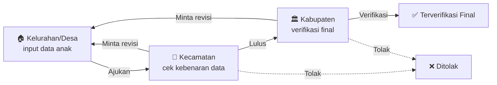

<div align="center">

# 🤝 SAHABAT
### Sistem Manajemen Data Anak Yatim

Data diinput **Kelurahan/Desa** → dicek **Kecamatan** → diverifikasi final oleh **Kabupaten**,
lengkap dengan dashboard, laporan, dan analisis pengelompokan wilayah (K-Means).


</div>

---

## 📑 Daftar Isi

1. [🚀 Instalasi (sampai siap dipakai)](#-instalasi-sampai-siap-dipakai)
2. [🔐 Login & akun demo](#-login--akun-demo)
3. [🧭 Gambaran alur](#-gambaran-alur)
4. [👥 Panduan per peran](#-panduan-per-peran)
5. [📊 Dashboard & Laporan](#-dashboard--laporan)
6. [🧮 Analisis K-Means](#-analisis-k-means)
7. [🧪 Menjalankan test](#-menjalankan-test)
8. [🛠️ Troubleshooting](#️-troubleshooting)
9. [🔒 Catatan keamanan](#-catatan-keamanan)
10. [📚 Dokumentasi lain](#-dokumentasi-lain)

---

## 🚀 Instalasi (sampai siap dipakai)

### 1. Siapkan dulu

| Kebutuhan | Versi | Cek dengan |
|---|---|---|
| **PHP** | 8.3 atau lebih baru | `php -v` |
| **Composer** | 2.x | `composer -V` |
| **Node.js + npm** | 20.19+ (disarankan LTS 22) | `node -v` |
| **Python** *(opsional, hanya untuk K-Means)* | 3.10+ | `python --version` |

Ekstensi PHP yang dibutuhkan: `intl`, `mbstring`, `pdo_sqlite`, `zip`, `fileinfo`, `openssl`, `curl`, `xml`.
Cek dengan `php -m`. Di Windows (XAMPP/Laragon), aktifkan baris `extension=intl` di `php.ini` jika belum.

### 2. Pasang (salin-tempel satu per satu)

**Windows (PowerShell):**

```powershell
# 1) Masuk ke folder project
cd manajemen-data-anak-yatim

# 2) Buat file database SQLite kosong
New-Item -ItemType File -Path database\database.sqlite -Force

# 3) Pasang semuanya sekaligus: composer install, .env, APP_KEY, migrate, npm install, npm build
composer setup

# 4) Isi data awal: wilayah, akun demo, kategori dokumen, dan data contoh
php artisan migrate:fresh --seed

# 5) Jalankan aplikasi
php artisan serve
```

**macOS / Linux:** sama persis, hanya langkah 2 diganti `touch database/database.sqlite`.

### 3. Buka di browser

> 👉 **http://127.0.0.1:8000/admin**

Login dengan salah satu [akun demo](#-login--akun-demo) di bawah. **Selesai, tinggal dipakai.** 🎉

> 💡 Alternatif: `composer dev` menjalankan server pengembangan beserta pendampingnya sekaligus.

<details>
<summary><b>Cara manual (jika <code>composer setup</code> bermasalah)</b></summary>

```powershell
composer install
Copy-Item .env.example .env          # macOS/Linux: cp .env.example .env
php artisan key:generate
New-Item -ItemType File -Path database\database.sqlite -Force
php artisan migrate:fresh --seed
npm install
npm run build
php artisan serve
```

</details>

---

## 🔐 Login & akun demo

Semua akun demo memakai kata sandi **`password`**.

| Peran | Email | Cakupan data |
|---|---|---|
| 🛡️ Super Admin | `superadmin@example.test` | Semua wilayah |
| 🏛️ Admin Kabupaten | `kabupaten.pelalawan@example.test` | Seluruh Kab. Pelalawan |
| 🏢 Admin Kecamatan | `kecamatan.pangkalan@example.test` | Kec. Pangkalan Kerinci |
| 🏠 Admin Kelurahan | `kelurahan.kerincikota@example.test` | Pangkalan Kerinci Kota |
| 🏠 Admin Kelurahan | `kelurahan.makmur@example.test` | Makmur |
| 🏢 Admin Kecamatan | `kecamatan.seikijang@example.test` | Kec. Bandar Sei Kijang |
| 🏠 Admin Kelurahan | `kelurahan.sekijang@example.test` | Sekijang |
| 🏛️ Admin Kabupaten | `kabupaten.kampar@example.test` | Seluruh Kab. Kampar *(untuk menguji isolasi antar-kabupaten)* |

> ⚠️ Akun dan data di atas **hanya untuk pengembangan**. Jangan dipakai di server sungguhan.

---

## 🧭 Gambaran alur



**Status permohonan**

| Status | Artinya | Ada di tangan |
|---|---|---|
| ⚪ Draft | Data masih disusun, belum diajukan | Kelurahan/Desa |
| 🔵 Menunggu Pengecekan Kecamatan | Sudah diajukan, menunggu dicek | Kecamatan |
| 🟠 Perlu Revisi | Dikembalikan beserta catatan perbaikan | Kelurahan/Desa |
| 🟣 Menunggu Verifikasi Kabupaten | Lulus cek kecamatan | Kabupaten |
| 🟢 Terverifikasi Final | Selesai | — |
| 🔴 Ditolak | Tidak memenuhi syarat (dengan alasan) | — |

**Cakupan data:** setiap peran hanya melihat wilayahnya sendiri. Kelurahan melihat desanya, kecamatan melihat semua kelurahan/desa di kecamatannya, dan kabupaten melihat seluruh kabupatennya.

---

## 👥 Panduan per peran

### 🏠 Admin Kelurahan / Desa: menginput data anak

1. Masuk, lalu lihat **Dashboard**. Kartu **"Perlu direvisi"** dan tabel tugas menunjukkan apa yang harus dikerjakan.
2. Buka menu **Data Anak**, lalu klik tombol buat baru di kanan atas.
3. Isi formulir lima langkah:
   1. **Data Anak & KK**: NIK, nama, tempat/tanggal lahir, jenis kelamin, nomor KK.
   2. **Alamat Domisili**: RT/RW, alamat, tinggal bersama siapa.
   3. **Orang Tua & Wali**: data ayah dan ibu (termasuk status hidup/meninggal), wali bila ada.
   4. **Rekening Bank**: rekening penerima.
   5. **Dokumen & Pengajuan**: unggah 11 dokumen persyaratan (umumnya PDF maks. 2 MB; pas foto berupa gambar).
4. Simpan sebagai **Draft** dulu bila belum lengkap, lalu lanjutkan kapan saja.
5. Jika semua dokumen sudah lengkap, klik **Ajukan** (di tab **Permohonan** pada halaman anak).
6. **Memantau:** buka baris anak, klik **Lihat**. Bagian **Progres Permohonan** menunjukkan posisi saat ini dan riwayat tindakan.
7. **Jika dikembalikan:** di halaman Lihat akan muncul kotak kuning berisi **siapa yang mengembalikan dan catatannya**. Perbaiki data atau dokumen lewat **Edit**, lalu **Ajukan** lagi.

> ℹ️ Menghapus data bersifat **sementara** (bisa dipulihkan lewat filter *Tempat sampah*). Hapus permanen hanya untuk Super Admin.

### 🏢 Admin Kecamatan: mengecek data

1. Di **Dashboard**, kartu **"Menunggu pengecekan Anda"** menunjukkan jumlah antrian. Klik untuk langsung ke sana.
2. Buka **Verifikasi → Verifikasi Permohonan**. Ada tiga tab:
   - **Antrian**: menunggu tindakan Anda (ada angka badge).
   - **Riwayat Saya**: yang sudah pernah Anda proses.
   - **Semua dalam Cakupan**: seluruh permohonan di kecamatan Anda.
3. Klik **Periksa** pada permohonan. Halaman ini menampilkan:
   - **Progres** permohonan,
   - **Dokumen Persyaratan**: daftar periksa per dokumen, dengan tautan untuk membuka/mengunduh berkasnya,
   - **Data anak, orang tua, dan alamat**,
   - **Rekening**: tanda ⚠ muncul bila nomor rekening yang sama terdaftar di **KK lain**.
4. Ambil keputusan lewat tombol di kanan atas:
   - ✅ **Lulus Verifikasi Kecamatan**: diteruskan ke kabupaten.
   - 🟠 **Minta Revisi**: *wajib* menulis catatan perbaikan.
   - 🔴 **Tolak**: *wajib* menulis alasan penolakan.

> Keputusan hanya bisa diambil di halaman **Periksa**, bukan dari tabel, supaya tidak ada persetujuan tanpa melihat data dan dokumen.

### 🏛️ Admin Kabupaten: verifikasi final & laporan

1. Di **Dashboard**, kartu **"Menunggu verifikasi Anda"** menunjukkan permohonan yang sudah lulus cek kecamatan.
2. Buka **Verifikasi Permohonan → Antrian → Periksa**. Cara kerjanya sama dengan kecamatan, tetapi tombolnya:
   - ✅ **Verifikasi Final Kabupaten**
   - 🟠 **Minta Revisi** / 🔴 **Tolak** (catatan wajib)
3. Buka menu **Laporan** untuk rekap status dan [analisis K-Means](#-analisis-k-means).

### 🛡️ Super Admin

Melihat semua wilayah dan satu-satunya peran yang dapat **menghapus permanen** data anak. Super Admin tidak memiliki antrian tugas.

---

## 📊 Dashboard & Laporan

### Dashboard (halaman awal): "apa yang harus saya kerjakan?"

Isinya menyesuaikan peran:

| | Kelurahan | Kecamatan | Kabupaten | Super Admin |
|---|:-:|:-:|:-:|:-:|
| Kartu tugas utama (bisa diklik) | ✅ | ✅ | ✅ | |
| Komposisi status (diagram donat) | ✅ | ✅ | ✅ | ✅ |
| Permohonan per wilayah bawahan | | per kelurahan/desa | per kecamatan | per kecamatan |
| Tabel "perlu tindakan" | ✅ | ✅ | ✅ | |

### Data Anak: mencari dan menyaring

Tabel mendukung pencarian (NIK, nama, No. KK, wilayah) dan filter:
jenis kelamin · status anak (**Yatim / Piatu / Yatim Piatu / Orang tua lengkap**) · kelompok usia (0–5, 6–12, 13–15, 16–18) · kecamatan · kelurahan/desa · status & periode permohonan · tempat sampah.

Filter yang dipilih **tetap tersimpan** selama sesi. Tombol **Lihat** membuka halaman baca-saja berisi identitas, alamat, orang tua/wali, dan progres permohonan.

### Laporan: "bagaimana gambaran besarnya?"

Rincian jumlah permohonan per status (dengan persentase), ditambah analisis pengelompokan wilayah untuk Admin Kabupaten dan Super Admin.

---

## 🧮 Analisis K-Means

Mengelompokkan **kelurahan/desa** menurut kinerja administrasi pengajuannya, supaya pendampingan bisa difokuskan ke wilayah yang membutuhkan.

### Fitur yang dihitung per wilayah

| Fitur | Arti |
|---|---|
| Rata-rata revisi | Seberapa sering pengajuan dikembalikan untuk diperbaiki |
| Persentase ditolak | Bagian pengajuan yang berakhir ditolak |
| Hari merespons revisi | Lama kelurahan/desa memperbaiki setelah dikembalikan |
| Hari draft → diajukan | Lama menyusun berkas sampai pertama kali diajukan |

> Lama proses di kecamatan/kabupaten **sengaja tidak dimasukkan**, karena itu kinerja kecamatan/kabupaten, bukan kelurahan/desa.

### Cara menjalankan

```powershell
# sekali saja: siapkan Python
python -m venv .venv
.venv\Scripts\activate
pip install -r resources\python\requirements.txt

# jalankan analisis
php artisan clustering:run --python=python
```

| Opsi | Fungsi | Bawaan |
|---|---|---|
| `--year=2026` | Hanya periode tertentu | semua tahun |
| `--k=3` | Paksa jumlah kelompok | otomatis (silhouette) |
| `--min-apps=5` | Minimum pengajuan per wilayah agar ikut | 5 |
| `--python=...` | Perintah/jalur Python | `python3` |

Lalu buka **Laporan** sebagai Admin Kabupaten atau Super Admin.

### Cara membaca hasil

- **Kelompok** diurutkan dari paling lancar ke paling butuh pendampingan. Namanya netral ("Administrasi lancar", "Sedang", "Perlu pendampingan"), bukan penilaian buruk.
- **Skor silhouette** menunjukkan seberapa jelas kelompok terpisah:

| Skor | Arti |
|---|---|
| ≥ 0,50 | 🟢 Struktur kelompok jelas |
| 0,25 – 0,50 | 🟡 Lemah, gunakan hati-hati |
| < 0,25 | 🔴 **Tidak bermakna**, jangan dijadikan dasar keputusan |

- Wilayah dengan pengajuan kurang dari minimum tampil sebagai **"Data belum cukup"**, dan wilayah yang belum pernah mengajukan dihitung terpisah.
- K-Means butuh **minimal 10 wilayah** yang memenuhi syarat dan nilai fitur yang bervariasi. Jika tidak, perintah berhenti dengan pesan penyebabnya.

### 🧪 Data simulasi (bila data asli belum tersedia)

```powershell
php artisan db:seed --class=WorkflowSimulationSeeder
php artisan clustering:run --python=python
```

Membuat 12 kecamatan Pelalawan dengan 118 wilayah **bernama fiktif** ("Desa Simulasi 007") lengkap dengan riwayat revisi/penolakan. Semua anak simulasi bernama "Anak Simulasi …" dan ber-NIK awalan `9999`.

> ⚠️ **Hasil dari data simulasi bukan temuan tentang wilayah mana pun.** Run-nya otomatis ditandai kartu merah **SIMULASI** di Laporan. Gunakan hanya untuk membuktikan bahwa sistem berjalan. Seeder ini menolak berjalan di lingkungan *production*.

---

## 🧪 Menjalankan test

```powershell
composer test
```

Atau satu per satu: `php artisan test --filter=DashboardServiceTest`.

---

## 🛠️ Troubleshooting

<details>
<summary><b>❌ Composer: <code>ext-intl</code> tidak ditemukan</b></summary>

Buka `php.ini`, hapus tanda `;` di depan `extension=intl`, lalu jalankan ulang perintahnya. Cek dengan `php -m`.

</details>

<details>
<summary><b>❌ Tampilan berantakan / tanpa gaya</b></summary>

Aset belum dibangun: jalankan `npm install` lalu `npm run build`.

</details>

<details>
<summary><b>❌ <code>could not find driver</code> / database tidak ditemukan</b></summary>

Aktifkan ekstensi `pdo_sqlite` di `php.ini`, dan pastikan file `database/database.sqlite` ada.

</details>

<details>
<summary><b>❌ Tidak bisa login</b></summary>

Pastikan sudah menjalankan `php artisan migrate:fresh --seed`, dan gunakan kata sandi `password`.

</details>

<details>
<summary><b>❌ <code>clustering:run</code>: "Skrip Python gagal" / python tidak ditemukan</b></summary>

- Di Windows gunakan `--python=python` (bukan `python3`), atau jalur venv: `--python=.venv\Scripts\python.exe`.
- Pasang dependensi: `pip install -r resources\python\requirements.txt`.

</details>

<details>
<summary><b>❌ <code>clustering:run</code>: "Hanya N wilayah yang memenuhi syarat"</b></summary>

Data belum punya cukup riwayat pengajuan. Seeder dummy bawaan membuat pengajuan **tanpa riwayat workflow**, sehingga tidak bisa dianalisis. Turunkan `--min-apps`, atau jalankan `WorkflowSimulationSeeder`.

</details>

<details>
<summary><b>🕒 Jam tampil lebih lambat dari waktu setempat</b></summary>

Zona waktu bawaan adalah UTC. Untuk WIB, ubah `'timezone' => 'UTC'` menjadi `'Asia/Jakarta'` di `config/app.php`.

</details>

---

## 🔒 Catatan keamanan

Aplikasi ini menyimpan **data anak** yang sensitif. Sebelum dipakai sungguhan:

- [ ] Set `APP_ENV=production` dan `APP_DEBUG=false` di `.env`.
- [ ] **Hapus akun demo** dan ganti semua kata sandi. Jangan jalankan seeder dummy/simulasi di server produksi.
- [ ] Gunakan **HTTPS** dan jangan pernah meng-commit file `.env`.
- [ ] Atur **backup rutin** database dan folder penyimpanan dokumen.
- [ ] Batasi akses server, karena dokumen persyaratan tersimpan di penyimpanan lokal aplikasi.
- [ ] Hapus permanen hanya untuk Super Admin, sedangkan peran lain hanya bisa menghapus sementara.

---

## 📚 Dokumentasi lain

| Dokumen | Isi |
|---|---|
| [`docs/database-design.md`](docs/database-design.md) | Rancangan awal database |
| [`.review/`](.review) | Catatan arsitektur, keputusan, dan domain |

---

<div align="center">

Dibuat dengan Laravel · Filament · scikit-learn

</div>